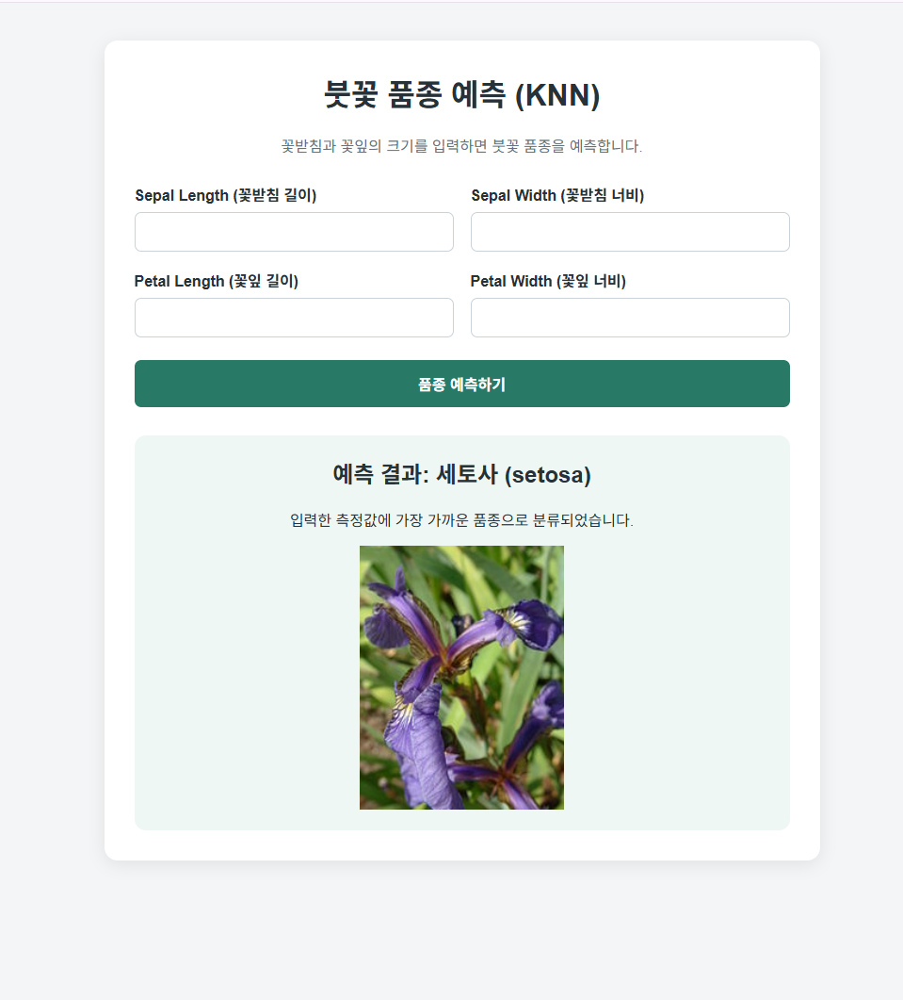
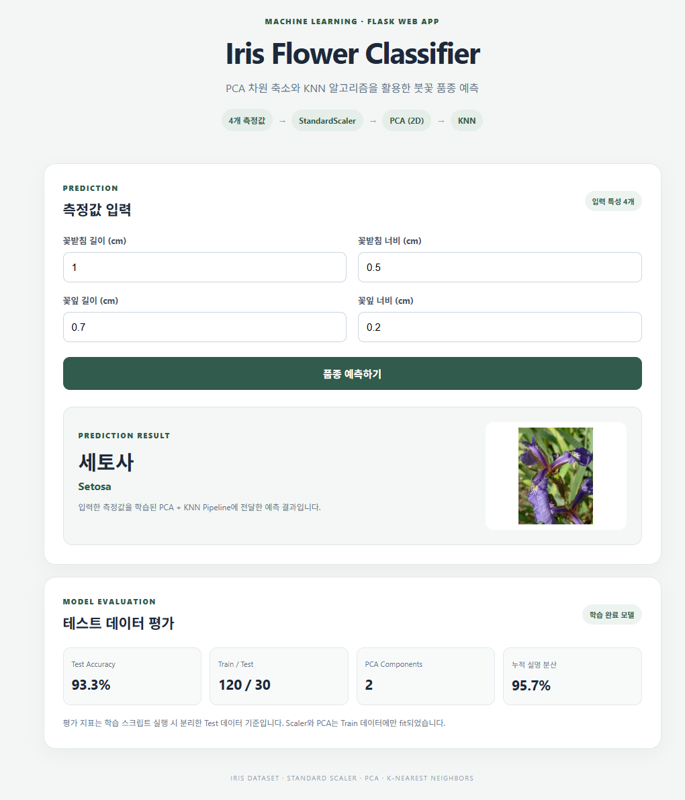

# Iris Flower Classifier (KNN)



꽃받침과 꽃잎의 길이·너비를 입력하면 KNN(K-Nearest Neighbors) 알고리즘으로 붓꽃 품종을 예측하고, 예측된 품종의 이미지를 웹 페이지에 표시하는 Flask 프로젝트입니다.

## 실습 목록

| 실습 | 폴더 | 내용 |
|---|---|---|
| 1. KNN 기본 | [`iris_knn_flask/`](iris_knn_flask) | 4개 측정값을 그대로 KNN에 넣어 품종 예측 |
| 2. PCA + KNN (추가 실습) | [`iris_pca_knn_flask/`](iris_pca_knn_flask) | StandardScaler → PCA(2차원) → KNN Pipeline, 테스트 평가 지표 표시 |

아래 내용은 실습 1(KNN 기본) 기준이며, 추가 실습은 문서 맨 아래 [추가 실습: PCA + KNN](#추가-실습-pca--knn)에 정리했습니다.

## 주요 기능
- 꽃받침 길이·너비와 꽃잎 길이·너비 입력
- 학습된 KNN 모델을 이용한 붓꽃 품종 예측
- 예측 결과에 따라 해당 품종 이미지 표시
  - Setosa (세토사)
  - Versicolor (버시컬러)
  - Virginica (버지니카)

## 기술 스택

| 구분 | 기술 |
|---|---|
| Language | Python |
| Web Framework | Flask |
| Machine Learning | scikit-learn |
| Model | K-Nearest Neighbors (KNN) |
| Data | scikit-learn Iris Dataset |
| Numerical Processing | NumPy |
| Model Storage | Pickle |
| Frontend | HTML, CSS |

## 프로젝트 구조

```text
iris_knn_flask/
├── app.py                  # Flask 서버 및 품종 예측 처리
├── train_model.py          # Iris 데이터 학습 및 모델 저장
├── model/
│   └── iris_model.pkl      # 학습된 KNN 모델
├── img/
│   ├── setosa.png
│   ├── versicolor.png
│   └── virginica.png
├── templates/
│   └── index.html          # 입력 폼 및 예측 결과 화면
├── result.png              # 실행 결과 스크린샷
└── README.md
```

## 실행 방법

### 1. 저장소 복제

```bash
git clone https://github.com/JHKINI/iris-flower-classifier.git
cd iris-flower-classifier
```

### 2. 라이브러리 설치

```bash
pip install flask numpy scikit-learn
```

### 3. Flask 서버 실행

```bash
python app.py
```

### 4. 웹 페이지 접속

브라우저에서 `http://127.0.0.1:5000`으로 접속합니다.

## 모델 학습

모델을 다시 학습하려면 프로젝트 루트 폴더에서 실행합니다.

```bash
python train_model.py
```

학습된 모델은 `model/iris_model.pkl`에 저장됩니다.

## 예측 과정

1. 사용자가 붓꽃의 네 가지 측정값을 입력합니다.
2. Flask가 입력값을 학습된 KNN 모델에 전달합니다.
3. 모델이 Setosa, Versicolor, Virginica 중 하나를 예측합니다.
4. 예측 결과에 해당하는 품종명과 이미지 파일을 연결합니다.
5. 결과 페이지에 예측 품종과 해당 붓꽃 이미지가 표시됩니다.

## 이미지 제공 방식

붓꽃 이미지는 `img/` 폴더에 저장되어 있습니다. Flask의 `/img/<파일명>` 경로와 `send_from_directory()`를 통해 브라우저에 이미지를 제공합니다.

## 참고
- scikit-learn에서 제공하는 Iris Dataset을 사용합니다.
- KNN 모델의 이웃 수는 `n_neighbors=3`으로 설정되어 있습니다.
- 학습 데이터와 테스트 데이터는 8:2 비율로 분리합니다.
- README 상단의 실행 화면을 표시하려면 결과 스크린샷 파일을 프로젝트 최상위 폴더에 `result.png`라는 이름으로 넣어야 합니다.

---

## 추가 실습: PCA + KNN



머신러닝 기초 수업 Chapter 6(차원축소)에서 배운 내용을 실습 1에 이어서 적용했습니다. 붓꽃 데이터의 4개 변수(꽃받침 길이·너비, 꽃잎 길이·너비)에서 주성분 2개를 추출해 2차원으로 줄인 뒤 KNN으로 분류합니다.

### 실습 1과 달라진 점

| 구분 | 실습 1 (`iris_knn_flask`) | 추가 실습 (`iris_pca_knn_flask`) |
|---|---|---|
| 전처리 | 없음 | StandardScaler 표준화 |
| 차원 | 원본 4차원 | PCA로 2차원 축소 |
| 모델 저장 | KNN 모델만 저장 | Scaler + PCA + KNN을 Pipeline 하나로 저장 |
| 데이터 분리 | 8:2 | 8:2, `stratify=y`로 품종 비율 유지 |
| 평가 | 없음 | Accuracy, Classification Report, Confusion Matrix |
| 웹 화면 | 예측 결과 + 이미지 | 예측 결과 + 이미지 + 테스트 평가 지표 |

### 처리 흐름

```text
4개 측정값 → StandardScaler → PCA (2D) → KNN (k=3) → 품종 예측
```

Train/Test를 먼저 나눈 뒤 Pipeline을 Train 데이터에만 `fit`해서, Test 데이터가 Scaler와 PCA 학습에 섞이지 않도록(데이터 누수 방지) 했습니다.

### 평가 결과 (Test 30개)

| 항목 | 값 |
|---|---|
| Train / Test | 120 / 30 |
| PCA 설명 분산 비율 | PC1 72.7%, PC2 23.1% |
| 누적 설명 분산 | 95.7% |
| Test Accuracy | 93.3% |

| 품종 | Precision | Recall | F1-score |
|---|---|---|---|
| setosa | 1.00 | 1.00 | 1.00 |
| versicolor | 0.83 | 1.00 | 0.91 |
| virginica | 1.00 | 0.80 | 0.89 |

Confusion Matrix (행: 실제, 열: 예측)

| | setosa | versicolor | virginica |
|---|---|---|---|
| **setosa** | 10 | 0 | 0 |
| **versicolor** | 0 | 10 | 0 |
| **virginica** | 0 | 2 | 8 |

### 정리

- 주성분 2개만으로 원본 분산의 약 95.7%를 설명합니다.
- setosa는 2차원에서도 완전히 분리되어 전부 맞혔습니다.
- 틀린 2건은 모두 virginica를 versicolor로 예측한 경우입니다. 두 품종은 2차원으로 줄였을 때 분포가 일부 겹치는 구간이 있어 생긴 오류로 보입니다.
- 같은 분할 조건(`stratify=y`, `random_state=42`)에서 PCA 없이 원본 4개 특성으로 KNN(k=3)을 돌리면 Test 30개를 모두 맞힙니다. 차원을 줄이면 시각화와 계산은 쉬워지지만 정보가 일부 손실될 수 있다는 점을 확인했습니다. (테스트 데이터가 30개뿐이라 2건 차이로 정확도가 크게 달라지는 점은 감안해야 합니다.)

### 실행 방법

```bash
cd iris_pca_knn_flask
pip install -r requirements.txt
python train_model.py   # 모델 학습 및 평가 (model/ 폴더에 저장)
python app.py           # http://127.0.0.1:5000 접속
```

자세한 설명은 [`iris_pca_knn_flask/README.md`](iris_pca_knn_flask/README.md)를 참고하세요.
