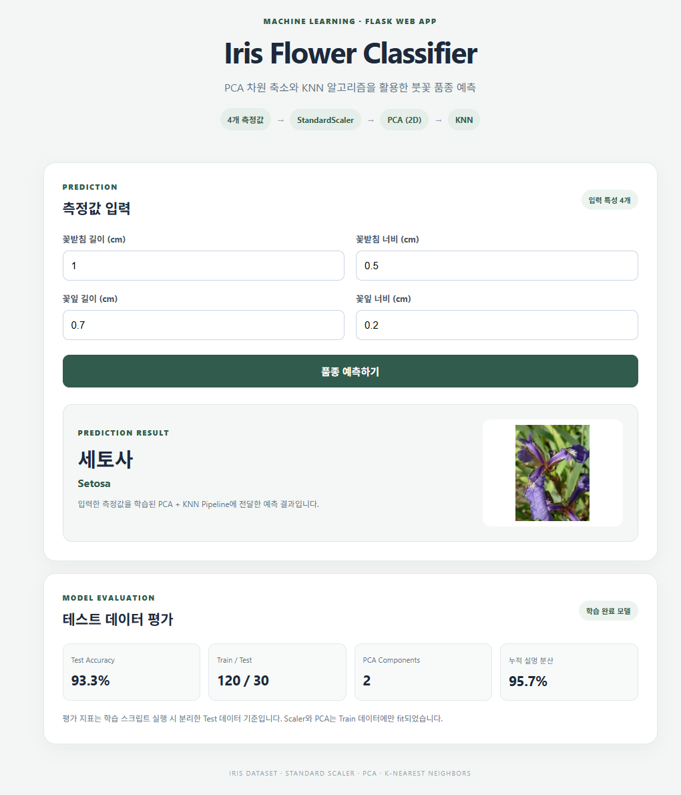

# Iris PCA + KNN Classifier



붓꽃(Iris) 데이터의 4개 측정 특성을 StandardScaler로 표준화한 뒤 PCA로 2차원 축소하고, KNN으로 품종을 분류하는 Flask 웹 애플리케이션입니다.

## 주요 기능

- Iris 데이터셋의 4개 특성(Sepal Length/Width, Petal Length/Width) 사용
- Train/Test 분리 후 Train 데이터만으로 StandardScaler와 PCA 학습
- PCA로 축소된 특성을 KNN 분류기에 전달
- 테스트 데이터 기준 Accuracy, Classification Report, Confusion Matrix 평가
- 학습된 전처리 및 분류 Pipeline을 Flask 웹 애플리케이션에서 재사용
- 예측 품종에 해당하는 붓꽃 이미지 표시

## 데이터 누수 방지

데이터 분리를 전처리보다 먼저 수행합니다.

```text
Iris Dataset
    |
Train/Test Split (80:20, stratify=y)
    |
    +------------------------------+
    |                              |
 Train                         Test
    |                              |
 StandardScaler.fit_transform      StandardScaler.transform
    |                              |
 PCA.fit_transform                 PCA.transform
    |                              |
 KNN.fit                          KNN.predict
    |                              |
    +---------- Test 평가 ---------+
```

`train_model.py`에서는 `Pipeline`을 사용합니다. `pipeline.fit(X_train, y_train)` 호출 시 StandardScaler와 PCA는 Train 데이터에 대해서만 학습됩니다. Test 데이터에는 `pipeline.predict(X_test)`만 호출하므로 Test 데이터로 Scaler/PCA의 평균, 표준편차, 주성분을 학습하지 않습니다.

웹 요청에서는 사용자가 입력한 원본 4개 특성을 Pipeline에 전달합니다. 저장된 Pipeline이 학습 당시의 Scaler와 PCA를 그대로 적용한 뒤 KNN 예측을 수행하므로, 웹에서 별도로 PCA를 다시 fit하지 않습니다.

## 기술 스택

- Python
- Flask
- NumPy
- scikit-learn
- StandardScaler
- PCA
- K-Nearest Neighbors (KNN)
- HTML / CSS

## 프로젝트 구조

```text
iris_pca_knn_flask/
├── app.py
├── train_model.py
├── requirements.txt
├── model/
│   ├── iris_pca_knn_pipeline.pkl
│   └── evaluation.json
├── img/
│   ├── setosa.png
│   ├── versicolor.png
│   └── virginica.png
├── templates/
│   └── index.html
└── static/
    └── css/
        └── style.css
```

## 실행 방법

### 1. 가상환경 생성 및 활성화 (선택)

Windows:

```bash
python -m venv venv
venv\Scripts\activate
```

### 2. 라이브러리 설치

```bash
pip install -r requirements.txt
```

### 3. 모델 학습 및 평가

```bash
python train_model.py
```

학습이 완료되면 다음 파일이 생성됩니다.

- `model/iris_pca_knn_pipeline.pkl`: StandardScaler + PCA + KNN 전체 Pipeline
- `model/evaluation.json`: 테스트 평가 결과와 PCA 설명 분산 정보

### 4. 웹 애플리케이션 실행

```bash
python app.py
```

브라우저에서 접속합니다.

```text
http://127.0.0.1:5000
```

## 현재 실험 설정

| 항목 | 설정 |
|---|---|
| 입력 특성 | Iris 데이터 4개 컬럼 |
| Train / Test | 80% / 20% |
| 데이터 분리 | `stratify=y`, `random_state=42` |
| 표준화 | StandardScaler |
| 차원 축소 | PCA, 2 components |
| 분류 모델 | KNeighborsClassifier |
| KNN 이웃 수 | 3 |

PCA의 설명 분산 비율과 최종 Test Accuracy는 `train_model.py` 실행 결과 및 `model/evaluation.json`에서 확인할 수 있습니다.

## 평가 결과

| 항목 | 값 |
|---|---|
| PCA 설명 분산 비율 | PC1 72.7%, PC2 23.1% (누적 95.7%) |
| Test Accuracy | 93.3% (30개 중 28개 정답) |

오답 2건은 모두 virginica를 versicolor로 예측한 경우입니다. setosa는 전부 맞혔습니다.

## 웹 예측 흐름

1. 사용자가 꽃받침 및 꽃잎의 길이·너비를 입력합니다.
2. Flask가 4개 원본 측정값을 2차원 배열로 구성합니다.
3. 저장된 Pipeline이 StandardScaler와 PCA를 순서대로 적용합니다.
4. KNN이 품종을 예측합니다.
5. 예측 품종명과 해당 이미지가 웹 페이지에 표시됩니다.

## 주의 사항

- `train_model.py`를 먼저 실행해 모델 파일을 생성한 다음 `app.py`를 실행해야 합니다.
- 학습과 웹 실행 환경의 scikit-learn 버전 차이가 크면 pickle 로딩 문제가 발생할 수 있으므로 동일한 환경에서 실행하는 것을 권장합니다.
- PCA는 차원을 줄이는 과정이므로 정보 일부가 손실될 수 있습니다. 원본 4개 특성 기반 KNN과 성능을 비교하면 PCA 적용 효과를 더 명확하게 확인할 수 있습니다.
